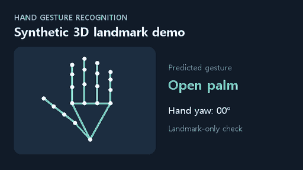

# 웹캠 손 제스처 인식

OpenCV로 영상 입력을 받고, MediaPipe Hands가 추정한 21개 3D 랜드마크에서 손가락의 굽힘과 손바닥 대비 거리를 계산해 제스처를 분류합니다.



위 GIF는 3D 좌표를 회전해 분류기로 보낸 시연입니다. 카메라 영상의 검출 성능은 아래 사진 검증과 별도로 봐야 합니다.

## 실행

Python 3.11 또는 3.12의 가상 환경에서 실행하세요. 카메라 입력과 영상 파일은 `Q` 또는 `Esc`로 닫습니다.

```bash
python -m pip install -r requirements.txt
python recgnize_gesture.py
python recgnize_gesture.py --video recording.mp4
python recgnize_gesture.py --image hand.jpg --no-display
```

기본 카메라 대신 다른 카메라를 쓰려면 `--camera 1`처럼 번호를 지정하세요.

## 검증 결과

| 테스트 | 결과 |
| --- | --- |
| 합성 랜드마크 | 제스처 7개 × 정면·45°·80° 회전, 총 21개 조합 일치 |
| 실제 이미지 표본 | MediaPipe 공개 사진에서 엄지, V, 검지 가리키기 3개 분류 확인 |
| 입력 예외 | 미지원 자세, 좌표 누락, 유효하지 않은 좌표는 분류 보류 |

합성 회전은 이미 검출된 좌표에 대한 분류기 테스트입니다. 실제 측면 촬영, 손가락 가림, 조명 변화에서의 정확도는 측정하지 않았습니다. 실제 사진은 구현 점검에 사용한 소수 표본입니다.

- [검증 사진 경로와 재현 절차](docs/image-checks.md)
- 코드 테스트 `python -m unittest discover -s tests -v`
- GIF 다시 만들기 `python tools/make_demo.py` (Pillow 필요)
